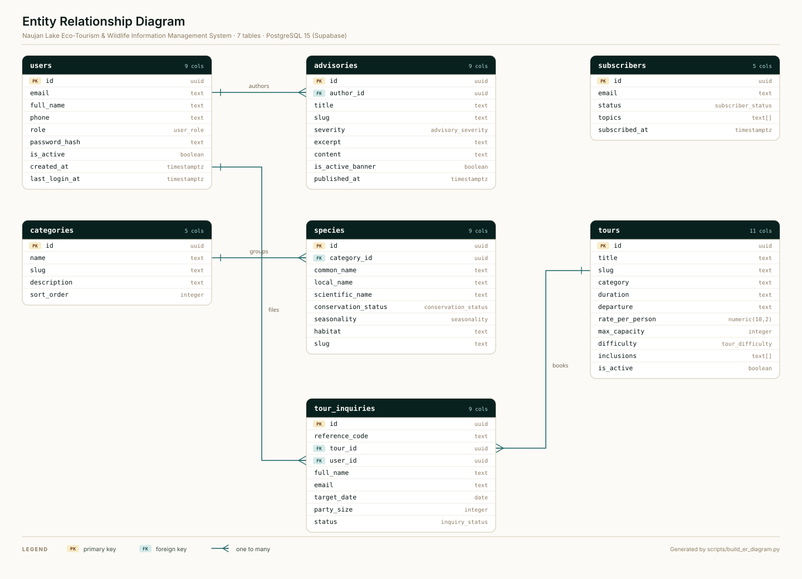
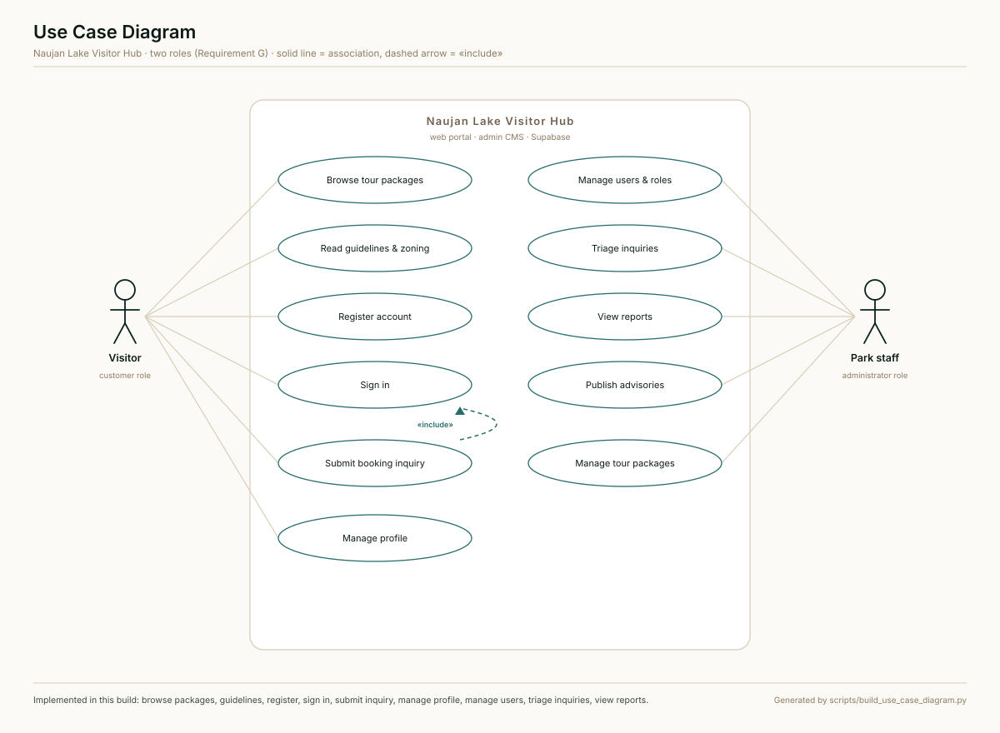

# Product Requirements Document (PRD)
## Naujan Lake Eco-Tourism & Wildlife Information Management System

- **Project Name:** Naujan Lake Eco-Tourism & Wildlife Information Management System (Visitor Hub)
- **Target Location:** Naujan Lake National Park (Ramsar Site No. 1008), Oriental Mindoro, Philippines
- **Document Version:** 1.1.0
- **Status:** Phase 1 & 2 implemented · Phase 3 planned
- **Author:** Troy R. Pajarito
- **Tech Stack:** Next.js 16 (App Router, Turbopack), React 19, TypeScript, Tailwind CSS v4, Supabase (PostgreSQL, Auth, Storage)
- **Related documents:** [Business Model & Revenue Plan](./REVENUE_MODEL.md) · [Database schema](../supabase/schema.sql) · [ER diagram](./figures/er_diagram.svg) · [Use case diagram](./figures/use_case_diagram.svg)

---

## 1. Executive Summary & Problem Statement

### 1.1 Context
Naujan Lake is the fifth largest lake in the Philippines, a proclaimed National Park, and a designated **Ramsar Wetland of International Importance**. It is a vital sanctuary for thousands of migratory waterbirds, rare waterfowl, and endemic freshwater aquatic species. 

### 1.2 The Problem
1. **Scattered & Outdated Information:** Information on biodiversity, tourist boat tours, visiting rates, and lake access points is fragmented across outdated social media posts and static pages.
2. **Lack of Structured Biodiversity Education:** Visitors and students have limited access to verified ecological data (IUCN conservation status, habitat information, seasonal migration schedules).
3. **Unregulated Tourism & Safety Concerns:** Absence of a centralized, accessible digital repository for park guidelines, lake zoning policies, safety protocols, and waste management rules increases ecological degradation risks.
4. **No Centralized Advisory or Notification Channel:** When severe weather, water level changes, or bird migration peaks occur, park authorities lack a direct notification mechanism for visitors and researchers.
5. **Technical Bottlenecks in Content Management:** Previous promotion efforts relied on manual updates or static code manipulation, preventing non-technical park rangers and municipal tourism staff from updating records easily.

### 1.3 The Solution
A unified, responsive **Information Management System and Visitor Hub** providing:
- A public-facing portal for wildlife discovery, eco-tourism packages, conservation guidelines, and real-time park advisories.
- A newsletter and membership system for visitor alerts and researcher access.
- A secure, role-based **Administrative Content Management System (CMS)** enabling authorized park staff to manage wildlife records, tour packages, advisories, and booking inquiries without writing code.

---

## 2. Product Vision, Goals & Success Metrics (KPIs)

### 2.1 Product Vision
To establish the definitive digital hub for Naujan Lake National Park that balances sustainable eco-tourism promotion with active wildlife conservation education and modern visitor engagement.

### 2.2 Core Product Goals
- **Promote Sustainable Eco-Tourism:** Highlight accredited local boat operators, eco-tourism packages, birdwatching viewpoints, and cultural heritage.
- **Educate on Biodiversity:** Provide an interactive, structured wildlife catalog featuring endemic and migratory species with conservation classifications.
- **Enhance Visitor Safety & Compliance:** Ensure all visitors have immediate access to lake rules, zoning regulations, and emergency contacts.
- **Empower Park Administrators:** Deliver an intuitive backoffice CMS for rapid publication of advisories, articles, and inventory of eco-tourism packages.

### 2.3 Key Success Metrics (KPIs)
| Metric Category | KPI Target |
| :--- | :--- |
| **Performance** | Core Web Vitals: LCP < 2.0s, CLS < 0.1, FID/INP < 100ms on 4G mobile networks |
| **Accessibility** | 100% compliance with WCAG 2.1 Level AA contrast and keyboard accessibility |
| **SEO & Discoverability** | 90+ Lighthouse SEO score; structured metadata for all wildlife species and tour packages |
| **Content Efficiency** | Admin can publish a critical park advisory or new wildlife entry in under 3 minutes |
| **Mobile Responsiveness** | Flawless rendering on mobile viewports (375px+ to 4K desktop) |

---

## 3. Target User Personas & User Journeys

### 3.1 Persona Profiles

#### Persona A: Eco-Tourist / Casual Visitor ("The Explorer")
- **Profile:** Domestic or international traveler planning a trip to Oriental Mindoro.
- **Needs:** View curated tour packages, boat hire fees, birdwatching seasons, directions, safety guidelines, and send booking inquiries.
- **Pain Points:** Hard to find official rates; uncertain about lake rules and current weather/water conditions.

#### Persona B: Student / Academic Researcher ("The Biologist")
- **Profile:** University researcher, high school student, or conservationist studying wetland ecology.
- **Needs:** Searchable biodiversity catalog, scientific taxonomy, IUCN/DENR conservation status, species descriptions, and high-resolution media.
- **Pain Points:** Lack of organized local databases; inconsistent taxonomy on informal websites.

#### Persona C: Park Administrator / Ranger / Tourism Officer ("The Custodian")
- **Profile:** DENR-PENRO / LGU Tourism staff or Bantay Lawa member managing Naujan Lake National Park.
- **Needs:** Easy backoffice dashboard to post urgent advisories, add newly cataloged wildlife, update tour tariffs, review inquiries, and broadcast newsletters.
- **Pain Points:** Inability to update websites without hiring a developer; difficulty reaching registered visitors quickly.

---

## 4. System Architecture & Tech Stack

```
                                  +---------------------------------------+
                                  |         Next.js 16 (Turbopack)        |
                                  |     React 19, TypeScript, Tailwind    |
                                  +-------------------+-------------------+
                                                      |
                         +----------------------------+----------------------------+
                         |                                                         |
                         v                                                         v
          +-------------------------------+                         +-------------------------------+
          |         Public Portal         |                         |      Admin CMS Dashboard      |
          | - Home & Hero Showcase        |                         | - Role-Based Access Control   |
          | - Wildlife Catalog & Search   |                         | - Species & Taxonomy Manager  |
          | - Eco-Tourism & Tour Packages |                         | - Tour Packages & Inquiries   |
          | - Park Rules & Zoning Map     |                         | - Advisories & Post Editor    |
          | - Advisories & News Feed      |                         | - Newsletter Subscribers List |
          | - Newsletter / Membership     |                         | - System Analytics & Metrics  |
          +---------------+---------------+                         +---------------+---------------+
                          |                                                         |
                          +----------------------------+----------------------------+
                                                       |
                                                       v
                                    +-------------------------------------+
                                    |         Backend Services Layer       |
                                    |    Supabase (PostgreSQL, Auth, RLS)  |
                                    |    - Auth: Visitor / Admin Roles    |
                                    |    - Storage: Media & Photo Buckets |
                                    |    - Edge Functions / Webhooks      |
                                    +-------------------------------------+
```

### 4.1 Tech Stack Specifications
- **Framework:** Next.js 16.3+ (App Router, Server Components & Server Actions)
- **Language:** TypeScript 5+ (Strict type-checking)
- **Styling:** Tailwind CSS v4 with curated design system inspired by `ui-ux-pro-max` (Nature palette: emerald/teal/slate/amber)
- **Icons:** Lucide React (standardized SVG icon set, strictly zero emojis as icons)
- **Database & Auth:** Supabase (PostgreSQL 15+, Row-Level Security, Supabase Auth with Role Claims)
- **Media Storage:** Supabase Storage (Optimized WebP images with Next.js Image caching)
- **Forms & Validation:** Zod + React Hook Form

---

## 5. Information Architecture & Sitemap

```
/
├── / (Home: Hero, Highlights, Lake Overview, Recent Advisories, CTA)
├── /wildlife (Searchable Biodiversity Directory)
│   ├── /[slug] (Detailed Species Profile & Conservation Information)
├── /tours (Eco-Tourism Packages, Boat Guides, Scenic Spots)
│   ├── /[slug] (Package Details & Booking Inquiry Form)
├── /guidelines (Park Rules, Lake Zoning, Waste Management & Safety)
├── /advisories (Conservation News, Seasonal Announcements & Urgent Alerts)
│   ├── /[slug] (Advisory / Article View)
├── /inquire (General Visitor Inquiry & Contact Form)
├── /subscribe (Newsletter Subscription & Preferences)
└── /admin (Secure Management Portal)
    ├── /login (Admin Authentication)
    ├── /dashboard (Overview Metrics & Quick Actions)
    ├── /species (Species CRUD & Media Upload)
    ├── /tours (Tour Packages CRUD)
    ├── /advisories (Advisories & News CMS)
    ├── /rules (Park Rules & Policies Editor)
    ├── /inquiries (Visitor Booking & Inquiry Management)
    └── /subscribers (Newsletter Audience Management)
```

> Routes marked in §12.4 as *planned* are specified here but not yet built; the implemented set is listed there with its source path.

---

## 6. Functional Requirements (FRD)

### Module 1: Wildlife Biodiversity Catalog
- **FR-1.1 Category Hierarchy:** Group species by Class (Waterbirds & Migratory Birds, Freshwater Fishes, Amphibians & Reptiles, Mammals, Wetland Flora).
- **FR-1.2 Species Profile Schema:**
  - Common Name (English)
  - Local Name (Tagalog/Mangyan where applicable)
  - Scientific Name (Italicized genus + species)
  - Conservation Status Tag (IUCN / DENR categories: *Critically Endangered, Endangered, Vulnerable, Near Threatened, Least Concern*)
  - Habitat & Distribution within Naujan Lake (Lake center, marshland, river mouths)
  - Seasonality / Presence (Year-round Resident, Migratory Winter Visitor [Oct-March])
  - Diet, Ecological Role & Identifying Features
  - High-resolution photo gallery with credits and caption
- **FR-1.3 Related Tours & Habitats:** Link wildlife profiles to relevant tour packages (e.g. Philippine Duck linked to Birdwatching Boat Tour).

### Module 2: Eco-Tourism Packages & Visitor Guide
- **FR-2.1 Package Listings:** Showcase approved eco-tourism activities:
  - Guided Birdwatching Expeditions
  - Scenic Sunrise/Sunset Boat Tours
  - Cultural & Lakeside Community Homestays
  - Educational Research Treks
- **FR-2.2 Package Profile Details:**
  - Itinerary overview & estimated duration
  - Maximum group capacity & guide requirements
  - Standard rate / tariff schedule (Breakdown of environmental fee, boat rental, tour guide fee)
  - What to bring / recommended attire
  - Physical difficulty level (Easy, Moderate, Challenging)
- **FR-2.3 Booking Inquiry Engine:**
  - Online inquiry submission (Full name, email, phone, date of visit, party size, package selected, special requests).
  - Generates a unique tracking reference code.
  - Sends immediate email confirmation to user and notification to the admin queue.

### Module 3: Park Rules, Regulations & Zoning
- **FR-3.1 Conservation Guidelines:** Clear, visual display of core rules:
  - Strict "No Littering / Leave No Trace" policy
  - Wildlife disturbance prohibitions (No flash photography during nesting, no feeding)
  - Fishing restrictions & prohibited gear within sanctuary areas
  - Life jacket requirements for all watercraft passengers
- **FR-3.2 Lake Zoning System:**
  - **Strict Protection Zone:** Closed to tourism; reserved for breeding birds and fish spawning.
  - **Recreational / Sustainable Use Zone:** Open for guided boat tours, designated photography points, and regulated angling.
  - **Buffer Zone:** Surrounding shoreline communities with controlled access.

### Module 4: News, Announcements & Park Advisories
- **FR-4.1 Advisory Levels:**
  - `CRITICAL` (Red banner: Severe typhoon warning, lake closure, flash flood alert)
  - `WARNING` (Amber banner: High water levels, restricted boat navigation)
  - `INFO / SEASONAL` (Emerald banner: Annual Asian Waterbird Census results, migratory bird arrival peaks)
- **FR-4.2 Persistent Top Banner:** Any active `CRITICAL` advisory automatically appears across all portal pages.
- **FR-4.3 Rich Text Article Publishing:** Full support for rich text formatting, embedded images, and PDF downloadable advisories.

### Module 5: Search, Filter & Taxonomy Engine
- **FR-5.1 Universal Keyword Search:** Search bar on navbar and catalog pages indexing species names, packages, and news.
- **FR-5.2 Multi-Facet Filters:**
  - Filter by Category (Birds, Fish, Plants, Reptiles)
  - Filter by Conservation Status (Endangered, Vulnerable, etc.)
  - Filter by Seasonality (Migratory, Resident)
- **FR-5.3 URL State Persistence:** Filters update URL query params (`?category=birds&status=vulnerable`) for easy bookmarking and sharing.

### Module 6: Membership & Newsletter System
- **FR-6.1 Public Subscription Form:** Instant email subscription with topic preferences (Park Advisories, Bird Migration Updates, Eco-Tour Promos).
- **FR-6.2 Member Registration (Optional):**
  - **General Visitor:** Save favorite species, track inquiry history.
  - **Researcher / Academic:** Request access to high-detail field notes and research archives.
- **FR-6.3 Automated Newsletter Dispatch:** Triggers email alerts to subscribers when critical advisories or monthly digests are published.

### Module 7: Administrative CMS & Backoffice Dashboard
- **FR-7.1 Role-Based Access Control (RBAC):**
  - `Super Admin`: User management, system configuration, full CRUD.
  - `Park Officer / Content Manager`: Create and edit species, tours, advisories, and manage inquiries.
  - `Inquiry Staff`: Read and update booking inquiry statuses.
- **FR-7.2 Dashboard Analytics:**
  - Total cataloged species & status breakdown
  - Active advisories count
  - Recent pending tour inquiries (Pending, Contacted, Confirmed, Cancelled)
  - Total newsletter subscribers
- **FR-7.3 Intuitive Data Management:** Easy tabular views with search, pagination, bulk operations, and media upload dialogs.

---

## 7. Database Schema & Data Models

The relational design is implemented in [`supabase/schema.sql`](../supabase/schema.sql): **seven tables**, seven enum types, thirteen indexes, row-level security on every table, and seed data that mirrors the demo accounts and tour packages shipped with the app. Run it in the Supabase SQL editor (or `psql "$DATABASE_URL" -f supabase/schema.sql`); it is idempotent.

### 7.1 Entity Relationship Diagram



*Figure 1 — ER diagram. Generated from the schema by `python scripts/build_er_diagram.py`; edit the script rather than the SVG.*

### 7.2 Relationships

| Parent | Child | Foreign key | Cardinality | Rule |
| :--- | :--- | :--- | :--- | :--- |
| `users` | `advisories` | `advisories.author_id` | 1 : N | Author removed → advisory kept (`ON DELETE SET NULL`) |
| `users` | `tour_inquiries` | `tour_inquiries.user_id` | 1 : N (nullable) | Account removed → inquiry kept for the park's records |
| `categories` | `species` | `species.category_id` | 1 : N | Category cannot be deleted while species reference it |
| `tours` | `tour_inquiries` | `tour_inquiries.tour_id` | 1 : N | Package cannot be deleted while inquiries reference it |
| `subscribers` | — | — | — | Standalone audience list |

A `species_media` gallery table is planned for FR-1.2 but is intentionally outside the seven core tables; the featured image is held on `species` for now.

### 7.3 Table Definitions

#### `users`
| Column | Type | Constraints | Description |
| :--- | :--- | :--- | :--- |
| `id` | UUID | PRIMARY KEY, DEFAULT `gen_random_uuid()` | Unique ID (mirrors `auth.users.id` once Supabase Auth is enabled) |
| `email` | TEXT | NOT NULL, UNIQUE, format check | Sign-in identifier |
| `full_name` | TEXT | NOT NULL, 2–120 chars | Display name |
| `phone` | TEXT | NULLABLE | Contact number, prefilled into inquiries |
| `role` | `user_role` | NOT NULL, DEFAULT `'visitor'` | `admin` (staff) or `visitor` (customer) |
| `password_hash` | TEXT | NOT NULL | Salted SHA-256 digest `sha256(email:password)` |
| `is_active` | BOOLEAN | NOT NULL, DEFAULT TRUE | Suspended accounts cannot sign in |
| `created_at` | TIMESTAMPTZ | NOT NULL, DEFAULT `now()` | Registration date |
| `last_login_at` | TIMESTAMPTZ | NULLABLE | Updated on each successful sign-in |

#### `categories`
| Column | Type | Constraints | Description |
| :--- | :--- | :--- | :--- |
| `id` | UUID | PRIMARY KEY | Unique ID |
| `name` | TEXT | NOT NULL, UNIQUE | E.g. "Waterbirds & Migratory Birds" |
| `slug` | TEXT | NOT NULL, UNIQUE | URL slug |
| `description` | TEXT | NULLABLE | Category description |
| `sort_order` | INTEGER | NOT NULL, DEFAULT 0 | Display order in the catalogue |
| `created_at` | TIMESTAMPTZ | NOT NULL, DEFAULT `now()` | Timestamp |

#### `species`
| Column | Type | Constraints | Description |
| :--- | :--- | :--- | :--- |
| `id` | UUID | PRIMARY KEY | Unique ID |
| `category_id` | UUID | NOT NULL, REFERENCES `categories(id)` | Taxonomy group |
| `common_name` | TEXT | NOT NULL | E.g. "Philippine Duck" |
| `local_name` | TEXT | NULLABLE | E.g. "Papan" |
| `scientific_name` | TEXT | NOT NULL | E.g. *Anas luzonica* |
| `conservation_status` | `conservation_status` | NOT NULL | CR, EN, VU, NT, LC, DD |
| `seasonality` | `seasonality` | NOT NULL | RESIDENT, MIGRATORY, SEASONAL |
| `habitat` | TEXT | NOT NULL | Distribution within the lake |
| `description` | TEXT | NOT NULL | Full profile |
| `featured_image` | TEXT | NOT NULL | Cover image URL |
| `slug` | TEXT | NOT NULL, UNIQUE | URL identifier |
| `created_at` / `updated_at` | TIMESTAMPTZ | NOT NULL, DEFAULT `now()` | Timestamps (`updated_at` maintained by trigger) |

#### `tours`
| Column | Type | Constraints | Description |
| :--- | :--- | :--- | :--- |
| `id` | UUID | PRIMARY KEY | Unique ID |
| `title` | TEXT | NOT NULL | E.g. "Sunrise boat tour" |
| `slug` | TEXT | NOT NULL, UNIQUE | URL slug |
| `category` | TEXT | NOT NULL | Birdwatching, Scenic, Cultural, Research |
| `summary` | TEXT | NOT NULL | One-paragraph description |
| `duration` | TEXT | NOT NULL | E.g. "3–4 hours" |
| `departure` | TEXT | NOT NULL | Time and meeting point |
| `rate_per_person` | NUMERIC(10,2) | NOT NULL, ≥ 0 | Published tariff in PHP |
| `max_capacity` | INTEGER | NOT NULL, 1–60 | Guests per booking |
| `difficulty` | `tour_difficulty` | NOT NULL | EASY, MODERATE, CHALLENGING |
| `inclusions` | TEXT[] | NOT NULL, DEFAULT `{}` | What the fee covers |
| `what_to_bring` | TEXT[] | NOT NULL, DEFAULT `{}` | Packing list |
| `notes` | TEXT[] | NOT NULL, DEFAULT `{}` | Caveats shown on the detail page |
| `itinerary` | JSONB | NOT NULL, DEFAULT `[]` | `[{time, title, detail}]` |
| `tariff` | JSONB | NOT NULL, DEFAULT `[]` | `[{label, amount}]`; sums to `rate_per_person` |
| `featured_image` | TEXT | NOT NULL | Cover image URL |
| `is_active` | BOOLEAN | NOT NULL, DEFAULT TRUE | Hidden from the public listing when false |
| `created_at` / `updated_at` | TIMESTAMPTZ | NOT NULL, DEFAULT `now()` | Timestamps |

#### `tour_inquiries`
| Column | Type | Constraints | Description |
| :--- | :--- | :--- | :--- |
| `id` | UUID | PRIMARY KEY | Unique ID |
| `reference_code` | TEXT | NOT NULL, UNIQUE | E.g. "NL-2026-104882" |
| `tour_id` | UUID | NOT NULL, REFERENCES `tours(id)` | Requested package |
| `user_id` | UUID | NULLABLE, REFERENCES `users(id)` | Signed-in visitor, when known |
| `full_name` | TEXT | NOT NULL | Visitor name |
| `email` | TEXT | NOT NULL, format check | Reply address |
| `phone` | TEXT | NULLABLE | Contact number |
| `target_date` | DATE | NOT NULL | Intended visit date |
| `party_size` | INTEGER | NOT NULL, 1–60 | Number of guests |
| `notes` | TEXT | NULLABLE | Special requests |
| `status` | `inquiry_status` | NOT NULL, DEFAULT `'PENDING'` | PENDING, CONTACTED, CONFIRMED, DECLINED |
| `created_at` / `updated_at` | TIMESTAMPTZ | NOT NULL, DEFAULT `now()` | Timestamps |

#### `advisories`
| Column | Type | Constraints | Description |
| :--- | :--- | :--- | :--- |
| `id` | UUID | PRIMARY KEY | Unique ID |
| `author_id` | UUID | NULLABLE, REFERENCES `users(id)` | Staff member who published it |
| `title` | TEXT | NOT NULL | Headline |
| `slug` | TEXT | NOT NULL, UNIQUE | URL slug |
| `severity` | `advisory_severity` | NOT NULL | CRITICAL, WARNING, INFO |
| `excerpt` | TEXT | NOT NULL | Summary shown in feeds |
| `content` | TEXT | NOT NULL | Full advisory body |
| `is_active_banner` | BOOLEAN | NOT NULL, DEFAULT FALSE | Pins it to the site-wide banner |
| `published_at` | TIMESTAMPTZ | NOT NULL, DEFAULT `now()` | Publication date |

#### `subscribers`
| Column | Type | Constraints | Description |
| :--- | :--- | :--- | :--- |
| `id` | UUID | PRIMARY KEY | Unique ID |
| `email` | TEXT | NOT NULL, UNIQUE, format check | Subscriber address |
| `status` | `subscriber_status` | NOT NULL, DEFAULT `'ACTIVE'` | ACTIVE, UNSUBSCRIBED |
| `topics` | TEXT[] | NOT NULL, DEFAULT `{advisories}` | Advisory, migration and promo preferences |
| `subscribed_at` | TIMESTAMPTZ | NOT NULL, DEFAULT `now()` | Date joined |

### 7.4 Access Control

Row-level security is enabled on all seven tables and enforced by a single helper, `public.is_admin()`, which resolves `auth.uid()` to `users.role`.

| Table | Public / anon | Authenticated visitor | Staff (`admin`) |
| :--- | :--- | :--- | :--- |
| `categories`, `species` | Read | Read | Full |
| `tours` | Read where `is_active` | Read where `is_active` | Full |
| `advisories` | Read where `published_at <= now()` | Same | Full |
| `users` | — | Read/update own row | Full |
| `tour_inquiries` | Insert (public form) | Read own (by `user_id` or email claim) | Full |
| `subscribers` | Insert | Insert | Read all |

---

## 8. Non-Functional Requirements (NFRs)

### 8.1 Performance & Scalability
- **Page Load Speed:** Server-Side Rendered (SSR) / Static Site Generation (SSG) with ISR for catalog pages. Sub-2s First Contentful Paint.
- **Image Optimization:** Automatic WebP delivery with Next.js `<Image>` component, responsive sizes, and lazy loading below the fold.

### 8.2 SEO & Social Discoverability
- Dynamic OpenGraph (OG) image generation and structured JSON-LD schemas (`TouristAttraction`, `Article`, `Species`).
- Human-readable canonical URLs and auto-generated XML sitemaps.

### 8.3 Accessibility & Design Excellence
- Adherence to WCAG 2.1 AA: Minimum 4.5:1 text contrast ratio for normal body copy and 3:1 for large headers.
- Full keyboard navigation (Tab index, visible focus rings, ARIA labels on all interactive icons).
- Nature-inspired color palette (Emerald green, lake blue, clean slate, amber accents) utilizing the project's `ui-ux-pro-max` guidelines. Zero amateur emoji icons; strictly professional Lucide SVG icons.

### 8.4 Security & Data Privacy
- Supabase Row-Level Security (RLS) policies enforcing that only authenticated administrators can mutate data.
- Input sanitization on all inquiry and subscription forms to prevent XSS and SQL injection.

---

## 9. Scope Boundaries: In-Scope vs. Explicitly Out-of-Scope

### 9.1 In-Scope
- Centralized public web portal (Wildlife directory, tour packages, park rules, advisories, search).
- Visitor tour booking inquiry workflow with reference tracking.
- Email newsletter subscription engine.
- Role-based Admin CMS backoffice for content and inquiry management.
- Responsive design across mobile, tablet, and desktop devices.

### 9.2 Explicitly Out-of-Scope
- **Physical IoT Sensor Hardware:** Real-time lake depth sensors, automated water salinity telemetry, or animal satellite collars.
- **Direct Online Payment Gateway Integration:** E-commerce credit card / GCash merchant checkouts (the system uses booking inquiry with on-site payment at park headquarters to comply with local LGU/DENR treasury regulations).
- **Emergency 911 Dispatching:** System provides emergency contact numbers but does not replace municipal 911 or Coast Guard rescue dispatch services.
- **Academic Thesis Overhead:** Student grading rubrics, statistical sampling formulas, and Likert scale matrices are strictly excluded from the production software.

---

## 10. Implementation Roadmap & Release Phases

### Phase 1: MVP (Core Public Visitor Hub)
1. **Design System & Layout:** Tailwind CSS setup with nature/lake theme, navigation bar, footer, and mobile drawer.
2. **Wildlife Catalog:** Searchable directory with categories, species detail pages, and status badges.
3. **Eco-Tours & Attractions:** Package cards, itinerary view, and booking inquiry modal/form.
4. **Park Guidelines & Zoning:** Interactive rules and conservation etiquette guide.
5. **Park Advisories:** Announcements feed and emergency warning banner.

### Phase 2: Administrative CMS & Data Layer
1. **Supabase Integration:** Database schema migration, RLS policies, and Auth setup.
2. **Admin Backoffice:** Protected dashboard layout, species management (CRUD + image upload), tour package management.
3. **Inquiry Management:** Admin dashboard to process, filter, and update visitor tour inquiries.
4. **Advisory CMS:** Publishing tool with instant critical banner toggling.

### Phase 3: Engagement & Optimization
1. **Newsletter Engine:** Automated notification triggers for new critical advisories.
2. **SEO & OpenGraph Enhancement:** Dynamic social cards for every species and package.
3. **Performance & A11y Audit:** Verification against Lighthouse scores and mobile responsive testing.

---

## 11. Business Model & Revenue

Requirement A is answered in full in [`REVENUE_MODEL.md`](./REVENUE_MODEL.md) — problem,
target users, value proposition, streams, unit economics, projection, break-even, risks.
This section is the summary that belongs in the product document.

### 11.1 Streams

| # | Stream | Who pays | Price |
| :- | :--- | :--- | :--- |
| 1 | Booking facilitation fee | Visitor, per confirmed booking | ₱150 flat |
| 2 | Operator commission | Accredited operator, per confirmed booking | 8% of tariff |
| 3 | Business listing | Homestays, eateries, souvenir stalls | ₱500 / month |
| 4 | Researcher membership | Academics, students, NGOs | ₱600 / year |
| 5 | Sponsored advisory slot | LGU, telco, conservation NGO | ₱2,500 / month |
| 6 | Paid education session | Schools on the research trek | ₱2,000 / session |

### 11.2 Headline numbers

| Metric | Value |
| :--- | ---: |
| Average gross booking value | ₱4,995 (3 guests × ₱1,665 blended rate) |
| Platform revenue per booking | ₱549.60 (₱150 fee + 8% commission) |
| Contribution per booking | ₱477.60 — **86.9% margin** |
| Year-one revenue | ₱291,987 |
| Year-one net | ≈ ₱112,400 (38% of revenue) |
| Break-even | 6 confirmed bookings / month once the non-booking streams are live |

The portal deliberately does **not** process online payments (see §9.2): tariffs are settled
at the park office and the platform invoices its fee and commission monthly. Only the fee and
commission are platform revenue, which is why the contribution margin is high — the product is
a coordination layer, not a tour operator.

### 11.3 Roles and permissions (Requirement G)

| Capability | Visitor (`visitor`) | Park staff (`admin`) |
| :--- | :--: | :--: |
| Browse packages, guidelines, advisories | ✓ | ✓ |
| Register / sign in / manage own profile | ✓ | ✓ |
| Submit a booking inquiry | ✓ | ✓ |
| See own inquiry history | ✓ | ✓ |
| See every inquiry and change its status | — | ✓ |
| List accounts, see role and join date | — | ✓ |
| View inquiry reports (status mix, demand by package) | — | ✓ |
| Publish advisories, manage packages (Phase 3) | — | planned |

Self-registration always writes `role = 'visitor'`; staff accounts are provisioned by the park
office. Enforcement is layered: the route guard in `components/admin/admin-shell.tsx` redirects
non-admins, and the database re-checks the same rule through `public.is_admin()` in §7.4.

---

## 12. Use Case Model

### 12.1 Actors

| Actor | Role | Description |
| :--- | :--- | :--- |
| **Visitor** | `visitor` | Tourist, student or researcher planning a trip. |
| **Park staff** | `admin` | DENR-PENRO / LGU tourism officer running the portal. |

### 12.2 Diagram



*Figure 2 — Use case diagram. Generated by `python scripts/build_use_case_diagram.py`.*

### 12.3 Narratives

**UC-5 · Submit booking inquiry** — the visitor picks a package (optionally arriving from the
package detail page, which passes `?tour=`), supplies date and party size, and submits. The
system requires a session (`«include»` UC-4 Sign in), writes a `tour_inquiries` row with a
generated `NL-YYYY-NNNNNN` reference, and the request appears in the staff queue.

**UC-8 · Triage inquiries** — staff open `/admin/inquiries`, review the queue newest-first and
move a request through PENDING → CONTACTED → CONFIRMED / DECLINED. Every change immediately
updates the status counters and the demand-by-package report above it.

**UC-9 · View reports** — the dashboard derives four KPIs (total, pending, confirmed, declined),
a status distribution and a per-package demand table from the same inquiry set, which is the
evidence base for the volume assumptions in the revenue model (§6).

### 12.4 Implementation status

| Use case | Route / source | Status |
| :--- | :--- | :--- |
| Browse tour packages | `/tours`, `/tours/[slug]` | Implemented |
| Read guidelines & zoning | `/guidelines` | Implemented |
| Register account | `/register` | Implemented |
| Sign in | `/login` | Implemented |
| Submit booking inquiry | `/inquire`, `lib/inquiries.ts` | Implemented |
| Manage profile | `/account` | Implemented |
| Manage users & roles | `/admin/users` | List and counters implemented; editing planned |
| Triage inquiries | `/admin/inquiries` | Implemented |
| View reports | `/admin/inquiries` | Implemented |
| Publish advisories | `/admin/advisories` | Planned |
| Manage tour packages | `/admin/tours` | Planned |

Authentication currently runs against a local account store (`lib/auth.ts`, salted SHA-256
digests, `localStorage` session) so the system can be demonstrated without a live Supabase
project. `supabase/schema.sql` is the production target; switching `lib/auth.ts` for Supabase
Auth is the remaining step for Requirement F.

The read-only catalogue does not wait for that step: with `NEXT_PUBLIC_SUPABASE_URL` and
`NEXT_PUBLIC_SUPABASE_ANON_KEY` set, `lib/species.ts`, `lib/tours.ts` and `lib/advisories.ts`
query Supabase through the anon key (RLS still applies) and cache the result with Next.js
`use cache`. Without those variables every getter serves the seed rows committed beside it, so
the portal keeps working offline (see `README.md` → Data layer).
