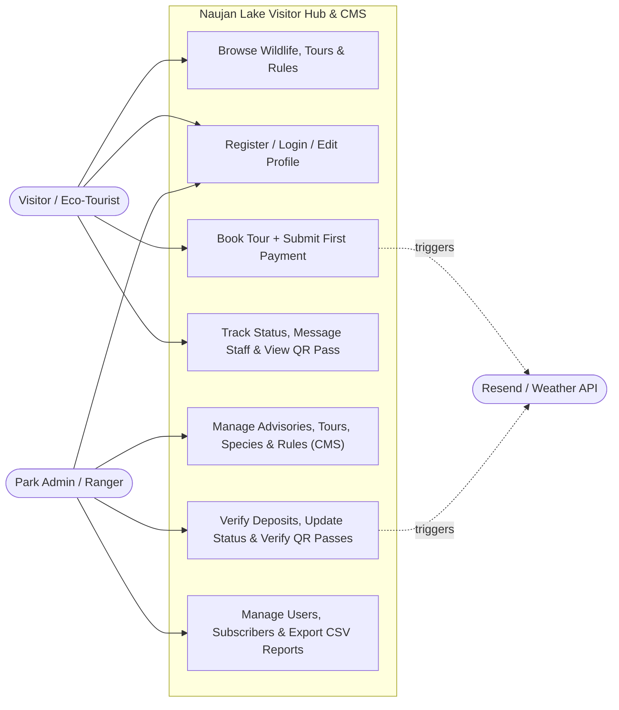
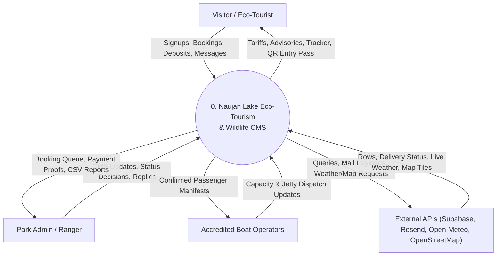
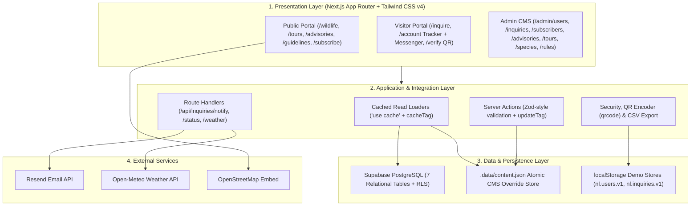
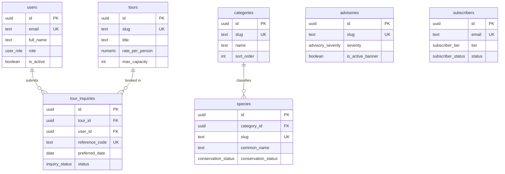

# System Design Document
## Naujan Lake Eco-Tourism & Wildlife Information Management System

- **Course:** Web Systems and Technologies 2 · System Integration and Architecture 1
- **Version:** 1.0 · November 2026
- **Related Documents:** [SRS](./SRS.md) · [Business Model & Revenue Plan](./REVENUE_MODEL.md) · [Product Requirements Document](./PRD.md) · [Database Schema](../supabase/schema.sql)

---

## 1. Use Case Diagram

The park platform serves three actor scopes across public discovery, tourist booking/tracking, and park staff content/operations management.

- **Diagram Figure:** [docs/figures/use_case_diagram.svg](./figures/use_case_diagram.svg)

---

## 2. Context Diagram (Level-0 DFD)

The Context Diagram defines the boundary between the Naujan Lake system and its external actors/integrations.

- **Diagram Figure:** [docs/figures/context_diagram.svg](./figures/context_diagram.svg)

---

## 3. System Architecture Diagram

The application uses a four-tier **Next.js 16 App Router** architecture combining React 19 UI, Next.js Cache Components (`"use cache"` + `updateTag()`), atomic JSON + Supabase PostgreSQL persistence, and external API adapters.

- **Diagram Figure:** [docs/figures/architecture_diagram.svg](./figures/architecture_diagram.svg)

---

## 4. Database Schema & Entity-Relationship Diagram (ERD)

The relational PostgreSQL schema in [supabase/schema.sql](../supabase/schema.sql) defines **7 normalized tables** (exceeding the minimum 5-table requirement) with enums, foreign keys, `updated_at` triggers, and Row-Level Security (RLS) policies:

1. **`users`** — Registered visitors and park administrators (`id`, `email`, `password_hash`, `full_name`, `phone`, `role`, `is_active`).
2. **`categories`** — 5 wildlife taxonomy categories (`id`, `slug`, `name`, `description`, `sort_order`).
3. **`species`** — Documented Naujan Lake wildlife (`id`, `category_id` FK -> `categories`, `slug`, `common_name`, `local_name`, `scientific_name`, `conservation_status`, `seasonality`, `habitat`, `description`, `featured_image`).
4. **`tours`** — Eco-tourism boat packages (`id`, `slug`, `title`, `tagline`, `description`, `duration`, `rate_per_person`, `max_capacity`, `departure_window`, `highlights`, `inclusions`, `is_available`).
5. **`advisories`** — Park safety & wildlife notices (`id`, `slug`, `title`, `severity`, `category`, `excerpt`, `content`, `actions`, `is_active_banner`, `published_at`, `effective_until`).
6. **`tour_inquiries`** — Visitor booking transactions (`id`, `reference_code`, `tour_id` FK -> `tours`, `user_id` FK -> `users`, `visitor_name`, `visitor_email`, `visitor_phone`, `preferred_date`, `party_size`, `first_payment_amount`, `payment_method`, `payment_status`, `status`, `notes`).
7. **`subscribers`** — Mailing list subscriptions (`id`, `email`, `full_name`, `tier`, `status`).

- **Diagram Figure:** [docs/figures/er_diagram.svg](./figures/er_diagram.svg)

---

## 5. UI Wireframes

The visual wireframe blueprints covering the Home Portal, Booking & First Payment Form, Visitor Account Tracker / Messenger / QR Pass, and Admin CMS Console are saved in:

- **Wireframes Sheet:** [docs/figures/wireframes.svg](./figures/wireframes.svg)
